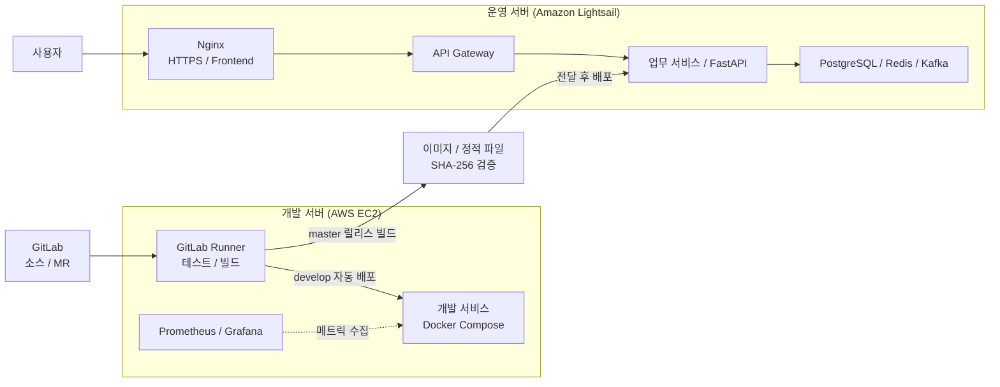
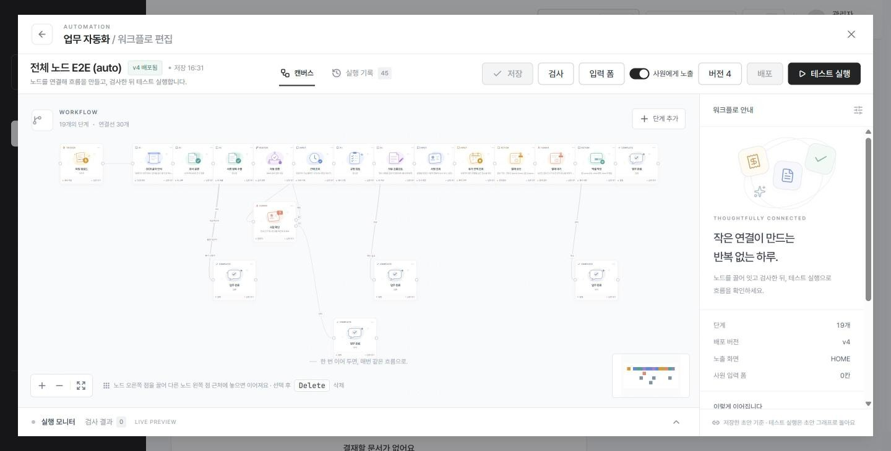
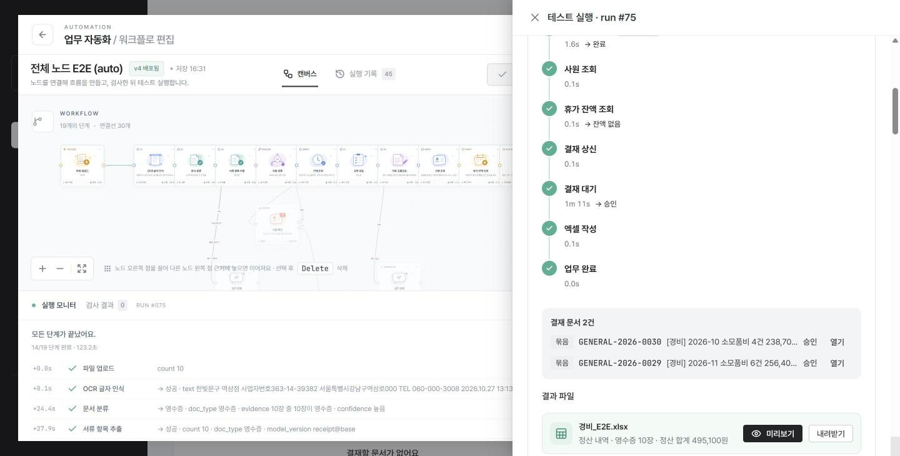
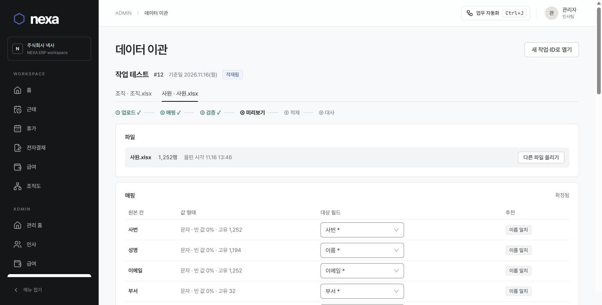
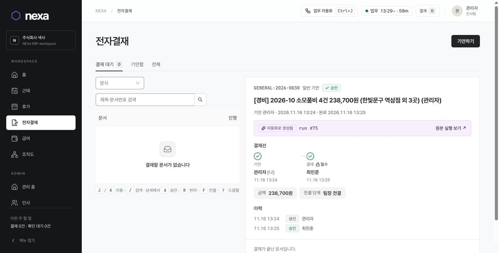
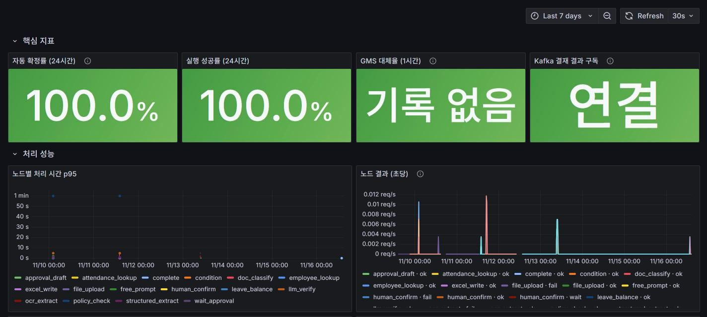

<div align="center">
  
  <h1>NEXA</h1>
  <p><strong>AI 업무 자동화 HR ERP</strong></p>
  <p>인사 · 근태 · 휴가 · 전자결재 · 급여를 하나로 연결하고<br>엑셀 데이터 이관과 AI 업무 자동화를 지원하는 MSA 기반 ERP</p>

  <p>
    
    
    
    
    
    
    
    
    
  </p>

  <p>SSAFY 자율 프로젝트 · 6인 · 8주<br>
  <strong>강석진 — Infrastructure / CI/CD 담당</strong></p>
</div>

<br>

> [!NOTE]
> SSAFY GitLab에서 팀으로 개발한 프로젝트를 커밋 이력과 함께 옮긴 저장소입니다.
> 제품 기능은 팀 전체의 결과물이고, **이 README의 트러블슈팅은 제가 맡은 인프라·배포 작업**입니다.
> 모든 수치는 Runner 로그, `sar`, Nginx 접속 로그에서 다시 확인한 실제 기록입니다. → [측정 방법](#-측정-방법)

<p align="center">
  <a href="#-핵심-성과">핵심 성과</a> ·
  <a href="#-트러블슈팅">트러블슈팅</a> ·
  <a href="#-아키텍처">아키텍처</a> ·
  <a href="#-cicd-파이프라인">CI/CD</a> ·
  <a href="#-주요-기능">주요 기능</a> ·
  <a href="#-기술-스택">기술 스택</a> ·
  <a href="DOCS/infra-troubleshooting.md">상세 기록</a>
</p>

<br>

## 📌 핵심 성과

| | Before | After | 어떻게 |
| :-- | :-- | :-- | :-- |
| 🚀 **배포 시간** | 서비스당 1~3분 | **30초 안팎** | CI가 만든 JAR를 배포에 재사용 |
| ⚡ **CI 빌드** | 2분 38초 | **1분 35초 (-40%)** | 서비스별 Gradle 의존성 캐시 |
| 🖥️ **운영 서버 부하** | 빌드 시 CPU 최대 95% | **빌드·모니터링 컨테이너 0개** | 개발 / 운영 서버 분리 |
| 🔒 **DB 권한** | 관리자 계정 1개 공유 | **서비스별 DB·계정 7쌍** | 초기화 스크립트 + Redis ACL |
| 🩹 **운영 장애** | 운영 도메인 로그인 403 | **약 1시간 내 복구** | CORS 허용 도메인 환경변수화 |

<br>

## 🙋 담당 역할

서비스를 띄우는 환경부터 테스트 · 배포 · 모니터링까지 인프라 전체 흐름을 맡았습니다.

| 영역 | 한 일 | 코드 |
| :-- | :-- | :-- |
| **실행 환경** | Compose를 데이터 / 플랫폼 / 백엔드 / AI / 모니터링 5개 파일로 분리, 헬스체크와 기동 순서 구성 | [compose.dev.yml](compose.dev.yml) · [infra/compose](infra/compose) |
| **CI/CD** | 바뀐 서비스만 빌드하는 Job 분리, MR 검증, develop 자동 배포, JAR 재사용, Gradle 캐시 | [.gitlab-ci.yml](.gitlab-ci.yml) · [.gitlab/ci](.gitlab/ci) |
| **서버 분리** | 개발 서버에서 빌드한 이미지·정적 파일을 체크섬 검증 후 운영 서버로 전달 | [트러블슈팅 3](#3-빌드가-몰리면-cpu가-95까지-치솟음) |
| **접근 제어** | 서비스별 PostgreSQL 계정, Redis ACL, Nginx HTTPS, 환경변수 주입 | [DB 초기화](infra/postgres/init/01-create-service-databases.sh) · [Redis ACL](infra/redis/start-redis.sh) |
| **모니터링** | Prometheus · Grafana · node-exporter 연동, CPU / RPS 대시보드 | [prometheus.yml](infra/monitoring/prometheus.yml) · [대시보드](infra/monitoring/grafana/dashboards/server-cpu.json) |

<br>

## 🔥 트러블슈팅

> 각 항목은 **문제 → 원인 → 해결 → 결과** 순서로 정리했습니다. 더 자세한 로그와 계산식은 [상세 기록](DOCS/infra-troubleshooting.md)에 있습니다.

### 1. 배포할 때마다 같은 코드를 두 번 컴파일함

| | |
| :-- | :-- |
| **문제** | 배포가 서비스마다 1~3분. 서비스가 7개라 여러 개가 같이 반영되면 대기가 길어짐 |
| **원인** | 테스트 단계에서 이미 JAR를 만들었는데, 배포용 Dockerfile 안에서 **Gradle 빌드를 한 번 더** 실행 |
| **해결** | CI 산출물(JAR)을 아티팩트로 넘기고, 배포는 JAR만 복사해 이미지 생성 |
| **결과** | 서비스 7개 배포 시간 **평균 1~3분 → 30초 안팎** |

```diff
- CI: Gradle 빌드 → 배포 Dockerfile: Gradle 빌드(중복) → 컨테이너 교체
+ CI: Gradle 빌드 → JAR 아티팩트 전달 → JAR만 COPY 해서 이미지 생성 → 컨테이너 교체
```

- 빌드 Job이 `build/libs/*.jar`를 아티팩트로 남기고, 배포 Job은 `needs`로 받아 씁니다.
- 실행용 JAR가 정확히 1개인지 검사한 뒤 [JAR 전용 Dockerfile](infra/docker/Dockerfile.ci)로 이미지를 만듭니다.
- `docker compose up --no-deps --no-build --wait`로 **해당 서비스만** 교체하고 헬스체크까지 기다립니다.

<details>
<summary><b>서비스별 배포 Job 평균 시간 (적용 커밋 전후)</b></summary>

| 서비스 | 적용 전 | 적용 후 |
| :-- | --: | --: |
| Approval | 167초 | **26초** |
| Eureka | 127초 | **14초** |
| Gateway | 124초 | **23초** |
| User | 110초 | **30초** |
| Attendance | 94초 | **32초** |
| Leave | 86초 | **26초** |
| Config | 59초 | **11초** |

</details>

📎 [배포 Job](.gitlab/ci/deploy.yml) · [JAR 전용 Dockerfile](infra/docker/Dockerfile.ci) · 적용 커밋 [`9a8c234`](https://github.com/doljeen/NEXA-ERP/commit/9a8c2342bf5a015033c499805c24ee34d9a5495b)

---

### 2. CI가 돌 때마다 Gradle 의존성을 처음부터 받음

| | |
| :-- | :-- |
| **문제** | 작은 변경에도 User 빌드 Job이 약 3분 |
| **원인** | CI는 매번 새 컨테이너에서 실행 → Gradle Wrapper와 라이브러리를 **매번 새로 다운로드** |
| **해결** | `GRADLE_USER_HOME`을 프로젝트 안으로 옮기고, Job 이름별로 캐시 분리 |
| **결과** | 같은 커밋 기준 Gradle 빌드 **2분 38초 → 1분 35초 (63초, 약 40% 단축)** |

```yaml
variables:
  GRADLE_USER_HOME: "$CI_PROJECT_DIR/.gradle-ci"
cache:
  key: "gradle-v1-$CI_JOB_NAME"     # 서비스(Job)별로 캐시 분리
  paths:
    - .gradle-ci/wrapper/            # Wrapper와
    - .gradle-ci/caches/modules-2/   # 의존성만 캐시 (빌드 결과물은 제외)
```

| 비교 | 캐시 없음 | 캐시 적중 |
| :-- | --: | --: |
| 같은 커밋의 User Gradle 빌드 | 2분 38초 | **1분 35초** |
| User 빌드 Job 전체 (적용 전후) | 약 183초 | **108~116초** |

📎 [캐시 설정](.gitlab/ci/gradle.yml) · 적용 커밋 [`0d20427`](https://github.com/doljeen/NEXA-ERP/commit/0d204273381b04c786ea25017193d8a6190d967a)

---

### 3. 빌드가 몰리면 CPU가 95%까지 치솟음

| | |
| :-- | :-- |
| **문제** | 평소 15% 안팎이던 CPU가 빌드가 몰리면 **10분 평균 최대 95.1%** |
| **원인** | 서버 1대에서 서비스 실행, CI 빌드(Runner), 모니터링을 모두 처리 |
| **판단** | 실사용자 요청과 빌드가 겹치면 응답 지연이나 서버 멈춤으로 이어질 수 있음 |
| **해결** | **개발 서버(EC2)와 운영 서버(Lightsail) 분리**, 운영 서버는 서비스만 실행 |
| **결과** | 운영 서버 컨테이너 13개 모두 healthy, Runner / Prometheus / Grafana **0개** |

<details>
<summary><b>CPU 기록 (<code>sar</code> 10분 평균, 11월 6~14일)</b></summary>

| 시점 (KST) | 10분 평균 CPU | 상황 |
| :-- | --: | :-- |
| 11월 6일 14:00 | **95.1%** | 빌드 Job 약 20개가 2개씩 동시 실행 |
| 기간 중 다른 최고값 | 94.1% · 88.5% · 85.7% | 빌드가 몰린 시간대 |
| 같은 기간 하루 평균 | 13.6 ~ 26.9% | 평소 |

</details>

| 서버 | 역할 |
| :-- | :-- |
| **개발 서버 (EC2)** | 개발용 서비스, GitLab Runner, 테스트·빌드, Prometheus · Grafana |
| **운영 서버 (Lightsail)** | Nginx, 업무 서비스, FastAPI, PostgreSQL, Redis, Kafka **만** 실행 |

- master 커밋은 개발 서버에서 이미지·정적 파일을 만든 뒤 **SHA-256으로 검증**해 운영 서버로 옮깁니다.
- 운영 릴리스에서 교체한 컨테이너 8개가 healthy였고, 배포한 `index.html`과 실제 HTTPS 응답의 해시가 일치함을 확인했습니다.

> [!IMPORTANT]
> 분리 전후 운영 서버의 응답 속도를 비교한 부하 테스트는 하지 않았습니다. 그래서 응답 속도 개선율은 성과로 적지 않았습니다.

📎 [상세 기록](DOCS/infra-troubleshooting.md) · [대시보드 설정](infra/monitoring/grafana/dashboards/server-cpu.json)

---

### 4. 모든 서비스가 관리자 DB 계정 하나를 공유함

| | |
| :-- | :-- |
| **문제** | 근태 서비스에 문제가 생기면 급여·회원 데이터까지 건드릴 수 있는 구조 |
| **원인** | PostgreSQL에 관리자 계정 하나만 만들고 모든 서비스가 그 계정으로 접속 |
| **해결** | DB 첫 기동 시 실행되는 [초기화 스크립트](infra/postgres/init/01-create-service-databases.sh)로 서비스별 DB·계정 7쌍 생성 |
| **결과** | 각 서비스는 **자기 DB에만 접속 가능**, 다른 서비스 DB 접속 차단 |

```sql
CREATE ROLE nexa_leave_app LOGIN PASSWORD ...;
CREATE DATABASE nexa_leave OWNER nexa_leave_app;
REVOKE ALL ON DATABASE nexa_leave FROM PUBLIC;              -- 다른 계정의 접속 차단
GRANT CONNECT, TEMPORARY ON DATABASE nexa_leave TO nexa_leave_app;
```

Redis도 같은 방식으로 서비스별 ACL 계정을 나눴습니다. → [start-redis.sh](infra/redis/start-redis.sh)

> **트레이드오프** — 새 서비스마다 계정을 추가해야 하지만, 한 서비스의 문제가 다른 서비스 데이터로 번지는 범위를 줄였습니다. 다만 PostgreSQL 인스턴스 자체는 하나라 DB 서버 장애까지 격리한 구조는 아닙니다.

---

### 5. 배포한 사이트에서 로그인만 403

| | |
| :-- | :-- |
| **문제** | 운영 도메인에서 `POST /api/v1/auth/login`이 계속 403. 서버 내부에서 직접 호출하면 400 → API 자체는 정상 |
| **원인** | Gateway의 CORS 허용 도메인이 코드에 `http://localhost:5173` **하나로 하드코딩** |
| **해결** | 허용 도메인을 `CORS_ALLOWED_ORIGINS` 환경변수로 분리해 서버마다 다른 값 주입 |
| **결과** | 원인 확인부터 복구까지 **약 1시간** |

| 시각 (11월 5일 KST) | Nginx 접속 로그 |
| :-- | :-- |
| 09:30 ~ 09:55 | 로그인 요청 403 × 6건 |
| 09:59 | CORS 환경변수 커밋 [`63eb905`](https://github.com/doljeen/NEXA-ERP/commit/63eb9057891f15a1e65415ab338884ca98c01041) |
| 10:30 | 첫 로그인 성공 (200) |

> **배운 점** — 로컬에서만 맞는 값이 코드에 박혀 있으면 배포 환경에서 터집니다. 도메인·키처럼 환경마다 달라지는 값은 처음부터 환경변수로 분리해야 합니다.

---

### 그 밖의 운영 이슈

| 증상 | 원인 | 해결 |
| :-- | :-- | :-- |
| `.env`를 고쳤는데 AI 서비스가 예전 키를 사용 | `docker restart`는 **생성 시점의 환경변수**를 그대로 씀 | 컨테이너를 recreate 하고 새 값 주입 여부 확인 |
| 한 서비스 배포가 다른 서비스의 오래된 배포에 막힘 | 서비스들이 같은 GitLab environment 이름을 공유 | `development/<서비스명>`으로 분리 |
| 빌드 산출물이 쌓여 디스크 사용량 증가 | 아티팩트 보관 기간이 김 | 보관 기간을 2일로 단축 |

<br>

## 🏗 아키텍처


업무 서비스마다 컨테이너와 DB 계정을 나눴고, PostgreSQL 인스턴스는 하나를 공유합니다.

### 배포 구조



<br>

## 🔄 CI/CD 파이프라인

| 트리거 | 동작 |
| :-- | :-- |
| **MR 생성** | `rules:changes`로 **바뀐 서비스만** 테스트·빌드. Java 서비스는 Testcontainers로 DB를 띄워 JUnit 실행 |
| **develop 머지** | 바뀐 서비스의 JAR 빌드 → 개발 서버 자동 배포 |
| **개발 배포** | JAR로 이미지 생성 → `compose up --no-deps --no-build --wait` → 헬스체크. `resource_group`으로 배포 순차 실행 |
| **master 머지** | 개발 서버에서 빌드 → 이미지·정적 파일 압축 → 체크섬 검증 → 운영 서버에서 로드·교체 → 헬스체크와 화면 해시 확인 |

> CI 설정은 개발 당시 GitLab 기준 기록입니다. GitHub로 옮긴 이 저장소에서는 자동 배포가 동작하지 않습니다.

<br>

## ✨ 주요 기능

| 영역 | 기능 |
| :-- | :-- |
| 인사 · 조직 | 사원·조직 정보 관리, 부서·직급 조회 |
| 근태 · 휴가 | 출퇴근 기록, 휴가·초과근무 신청을 전자결재와 연결 |
| 전자결재 | 기안, 결재선 구성, 승인·반려, 결과를 관련 서비스로 이벤트 전달 |
| 급여 | 근태·기준 정보로 급여 계산, 명세서 조회 |
| 데이터 이관 | 엑셀·CSV 업로드 → 컬럼 매핑 → 검증 → 미리보기 → 적재 |
| AI 업무 자동화 | OCR · 정보 추출 · 규정 검토 · 사람 확인 · 결재 · 엑셀 생성 노드를 연결해 반복 업무 실행 |

| AI 업무 자동화 빌더 | 워크플로 실행 결과 |
| :---: | :---: |
|  |  |
| **데이터 이관 · 컬럼 매핑** | **자동 상신된 결재 문서** |
|  |  |

<details>
<summary><b>Grafana 모니터링 화면</b></summary>



</details>

기능별 상세 설명은 [프로젝트 소개](DOCS/project-overview.md)에 있습니다.

<br>

## 🛠 기술 스택

| 구분 | 기술 |
| :-- | :-- |
| **Frontend** | React 18, TypeScript, Vite, TanStack Query, Zustand, React Flow |
| **Backend** | Java 21, Spring Boot 4, Spring Cloud Gateway, Eureka, Config, JPA, Flyway |
| **AI** | Python, FastAPI, LangGraph, DSPy, vLLM, PaddleOCR, MLflow |
| **Data** | PostgreSQL 17, Redis 7, Kafka 3.9 |
| **Infra** | AWS EC2, Amazon Lightsail, Docker Compose, Nginx, Certbot, Tailscale |
| **CI · 모니터링** | GitLab CI/CD, Gradle, Testcontainers, Prometheus, Grafana, node-exporter, kafka-exporter |

<br>

## 📏 측정 방법

위 숫자는 개발 서버에 **읽기 전용으로 접속해 기록을 다시 확인한 값**입니다.

| 항목 | 출처 | 방법 |
| :-- | :-- | :-- |
| 배포 시간 | GitLab Runner Job 로그 | 적용 커밋 `9a8c234` (10/28 10:05) 전후 서비스별 배포 Job 평균 |
| Gradle 캐시 | Runner 로그 `BUILD SUCCESSFUL in ...` | 같은 커밋의 첫 실행 vs 캐시 적중 실행, Job 시간은 `0d20427` 전후 비교 |
| CPU 사용률 | `sar` 10분 평균 (11/6 ~ 11/14) | 하루 평균·최고값 추출 후 최고값 시각의 Runner Job 수와 대조 |
| 로그인 403 | Nginx access log | `/api/v1/auth/login` 상태 코드·시각을 커밋 시각과 대조 |
| 서버 분리 | 두 서버의 `docker ps` | 운영 13개 / 개발 18개 컨테이너 목록 비교 |

짧은 기간의 실제 기록이며, 같은 조건으로 반복한 실험 평균은 아닙니다. 부하 테스트 기반 응답 속도·동시 사용자 수는 포함하지 않았습니다.

<br>

## 🧭 한계와 다음 과제

- [ ] PostgreSQL과 Gateway가 각각 1개 → 둘 중 하나가 죽으면 전체 서비스 영향 (**SPOF**)
- [ ] 운영 배포가 컨테이너 단위 교체라 교체 순간 짧은 중단 가능 → 무중단(Blue-Green / Rolling) 배포 필요
- [ ] 운영 서버 부하 테스트로 서버 분리 효과를 수치화
- [ ] Gateway 다중화, DB 분리 및 이중화

<br>

## 📁 폴더 구조

```text
NEXA-ERP
├── Backend/            업무 서비스, Gateway, Eureka, Config, 공통 인증 라이브러리
├── FastAPI/            AI 워크플로, GPU 연동, MLOps
├── Frontend/           ERP 화면과 업무 자동화 빌더
├── .gitlab/ci/         서비스별 CI/CD Job
├── infra/
│   ├── compose/        데이터 · 플랫폼 · 백엔드 · AI · 모니터링 Compose
│   ├── docker/         CI가 만든 JAR로 이미지를 만드는 Dockerfile
│   ├── postgres/       서비스별 DB와 계정 초기화
│   ├── redis/          서비스별 Redis ACL
│   └── monitoring/     Prometheus 설정, Grafana 대시보드
├── DOCS/               기능 설명, 이벤트 계약, QA, 인프라 트러블슈팅
├── compose.dev.yml     전체 Compose 진입점
└── .env.example        환경변수 템플릿
```

<details>
<summary><b>로컬 실행 (참고)</b></summary>

```bash
cp .env.example .env      # 비밀번호 등 값 채우기
docker compose -f compose.dev.yml up -d
```

전체를 띄우려면 별도 Config 저장소, 서비스별 비밀번호, 공통 라이브러리가 올라간 GitLab Maven 저장소 접근 권한이 필요합니다. 공개본에는 실제 환경변수와 인증 키를 넣지 않았습니다.

</details>

<br>

## 👥 팀 구성

| 이름 | 역할 |
| :-- | :-- |
| 황문규 | Leader / Backend |
| 박성현 | Backend |
| 황우찬 | Backend |
| 김동현 | Backend / AI |
| 김승환 | Backend / Data |
| **강석진** | **Infrastructure / CI/CD** |

<sub>원본: SSAFY GitLab `S15P31D107` 프로젝트의 `develop` 브랜치. GitHub로 옮기며 이력을 재작성해 커밋 SHA가 원본과 다릅니다.</sub>
