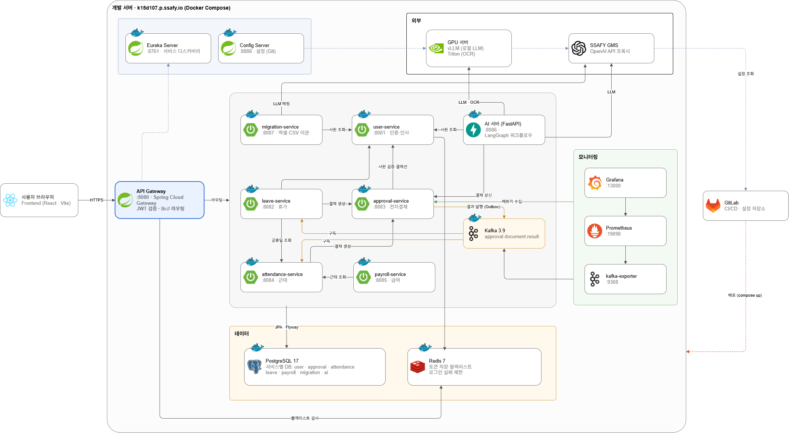
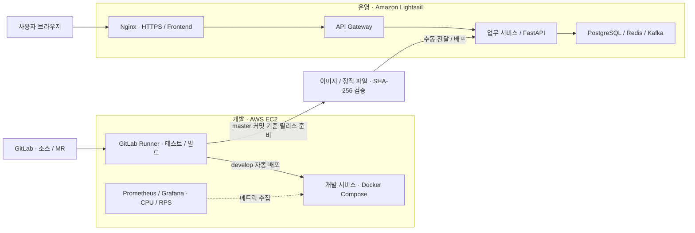

<div align="center">
  
  <h1>NEXA · AI 업무 자동화 HR ERP</h1>
  <p>인사·근태·휴가·전자결재·급여를 연결하고, 엑셀 데이터 이관과 AI 업무 자동화를 지원합니다.</p>
  <p><strong>SSAFY 팀 프로젝트 · 6명 · 8주</strong></p>
  <p>강석진 · Infrastructure / CI/CD</p>
</div>

팀이 GitLab에서 개발한 NEXA의 소스와 기능 화면을 옮기고, **제가 담당한 인프라 구성·배포 자동화·빌드 성능 개선 경험**을 정리한 포트폴리오입니다. 제품 기능은 팀 전체의 결과물이며, 개인 기여는 별도 항목에 표시했습니다.

[주요 기능](#주요-기능) · [담당 역할](#담당-역할--강석진) · [트러블슈팅](#핵심-트러블슈팅) · [CI/CD](#cicd-구성) · [상세 기록](DOCS/infra-troubleshooting.md)

## 주요 기능

| 영역 | 사용자가 할 수 있는 일 |
| --- | --- |
| 인사·조직 | 사원과 조직 정보를 관리하고 부서·직급·직책을 조회합니다. |
| 근태·휴가 | 출퇴근 기록과 근태 내역을 확인하고 휴가·초과근무 신청을 전자결재와 연결합니다. |
| 전자결재 | 문서 기안, 결재선 구성, 승인·반려 처리와 관련 서비스로의 결과 전달을 지원합니다. |
| 급여 | 근태와 급여 기준정보를 바탕으로 급여를 계산하고 명세서를 조회합니다. |
| 데이터 이관 | 엑셀·CSV 업로드, 컬럼 매핑, 검증, 미리보기, 적재, 대사를 진행합니다. |
| AI 업무 자동화 | OCR·정보 추출·규정 검토·사람 확인·결재·엑셀 생성 노드를 연결해 반복 업무를 실행합니다. |

### 기능 화면

| AI 업무 자동화 빌더 | 워크플로 실행 결과 |
| :---: | :---: |
|  |  |

| 데이터 이관과 컬럼 매핑 | 자동으로 상신된 결재 문서 |
| :---: | :---: |
|  |  |

노드별 실행 과정, 규정 RAG, 모델 학습·승격 등 세부 기능은 [팀 프로젝트 상세 소개](DOCS/project-overview.md)에서 볼 수 있습니다.

## 담당 역할 · 강석진

**서비스 실행 환경부터 검증·배포·관측까지 이어지는 인프라 흐름을 담당했습니다.**

| 담당 영역 | 구현 내용 | 관련 코드 |
| --- | --- | --- |
| 서비스 실행 환경 | Compose를 데이터·플랫폼·백엔드·AI·모니터링으로 분리하고 헬스체크·기동 의존성 구성 | [Compose 진입점](compose.dev.yml), [서비스 구성](infra/compose) |
| GitLab CI/CD | 변경 경로별 Job, MR 검증, develop 자동 배포, JAR 아티팩트 재사용과 Gradle 캐시 | [파이프라인](.gitlab-ci.yml), [CI 설정](.gitlab/ci) |
| 개발·운영 분리 | 개발 EC2에서 테스트·빌드한 이미지와 정적 파일을 운영 Lightsail로 전달하는 배포 절차 구성 | [운영 배포 기록](DOCS/infra-troubleshooting.md#3-ci-부하와-운영-요청의-자원-경쟁-분리) |
| 모니터링 | Prometheus·Grafana·node-exporter 연동, 서버 CPU 사용률·Gateway RPS 패널 추가 | [수집 설정](infra/monitoring/prometheus.yml), [CPU·RPS 패널](infra/monitoring/grafana/dashboards/server-cpu.json) |
| 운영 설정·접근 제어 | Nginx·HTTPS, 서비스별 DB 계정·Redis ACL, 환경변수 주입과 서비스 간 연동 검증 | [인프라 코드](infra) |

## 핵심 트러블슈팅

### 1. 배포 단계에서 같은 코드를 다시 컴파일하는 문제

CI에서 JAR를 생성했는데도 배포용 Docker 이미지 빌드 과정에서 Gradle이 다시 실행됐습니다. 이미 만든 산출물을 다시 생성하는 작업이 배포 시간을 늘리고 있었습니다.

CI의 실행용 JAR를 아티팩트로 전달하고, 배포용 Dockerfile은 JAR를 이미지에 넣는 작업만 하도록 바꿨습니다. Compose는 `--no-build`로 대상 서비스를 갱신합니다.

**결과 — 배포 단계의 중복 Java 컴파일을 제거하고, CI가 만든 JAR를 배포 이미지에 그대로 사용했습니다.**

[배포 Job](.gitlab/ci/deploy.yml) · [CI 산출물용 Dockerfile](infra/docker/Dockerfile.ci)

### 2. Gradle 캐시로 반복 빌드 시간 단축

컨테이너 기반 CI에서 Gradle Wrapper와 의존성을 다시 내려받는 비용을 확인했습니다. `GRADLE_USER_HOME`을 지정하고 Job별로 캐시를 재사용하도록 구성했습니다.

| 비교 대상 | 캐시 미적중 실행 | 캐시 적중 실행 | 관측 결과 |
| --- | --- | --- | --- |
| 동일 커밋의 User 서비스 Gradle 작업 | 2분 38초 | 1분 35초 | **63초 단축 · 약 40% 감소** |

같은 MR 커밋의 두 실행 로그에 나온 `BUILD SUCCESSFUL` 시간을 비교한 결과입니다. 전체 파이프라인 시간이나 모든 서비스의 평균 개선율을 의미하지 않습니다.

[캐시 설정](.gitlab/ci/gradle.yml) · [측정 조건과 근거](DOCS/infra-troubleshooting.md#2-gradle-캐시로-반복-빌드-시간-단축)

### 3. CI 부하와 운영 요청의 자원 경쟁 분리

개발 서버에서 여러 서비스의 CI가 실행될 때, 서버 전체 CPU 사용률이 **1분 평균 기준 약 84%**까지 오르는 것을 확인했습니다. 실제 사용자 요청까지 같은 서버에서 처리하면 자원 경쟁이 발생할 수 있다고 판단했습니다.

개발 서버에서 테스트·이미지 빌드를 수행하고, 운영 서버에는 만들어진 이미지와 정적 파일을 전달하도록 분리했습니다. 운영 서버에는 GitLab Runner와 개발용 모니터링 스택을 올리지 않았습니다.

**결과 — 운영 서버가 요청을 처리하는 동안 CI 컴파일 작업을 함께 수행하지 않도록 구성했습니다.** 운영 응답 속도나 최대 동시 사용자 수를 측정한 결과는 아닙니다.

[개발·운영 구성과 배포 검증 기록](DOCS/infra-troubleshooting.md#3-ci-부하와-운영-요청의-자원-경쟁-분리)

## 아키텍처

### 서비스 구성



위 그림은 **개발 환경의 서비스 연동 구조**입니다. 운영 환경은 별도 Lightsail 서버로 분리했습니다. 업무 서비스는 컨테이너와 DB·계정을 구분하지만 PostgreSQL 인스턴스와 서버 자체는 공유합니다.

### 개발·운영 환경 분리



## CI/CD 구성

| 시점 | 수행 작업 |
| --- | --- |
| MR 생성·업데이트 | `rules:changes`에 해당하는 서비스 테스트·빌드. Java 서비스는 JUnit 결과를 보고하고 필요한 외부 의존성을 Testcontainers로 구성 |
| develop 반영 | 대상 서비스의 산출물 생성 후 개발 서버에 자동 배포. Java Job은 재테스트를 생략하고 JAR 생성 |
| 개발 배포 | JAR로 이미지 구성 → `compose up --no-deps --no-build --wait` → 헬스체크 확인. `resource_group`으로 배포 Job 직렬화 |
| master 운영 반영 | 개발 서버에서 해당 커밋 빌드 → 이미지·정적 파일 압축 → 체크섬 검증 → 운영 서버에서 로드·서비스 갱신 → 헬스체크·프론트 해시 확인 |

Leave 서비스의 현재 Job은 MR에서도 `bootJar -x test`를 사용합니다. GitLab CI 설정과 운영 수동 배포 절차를 함께 사용했으며, 이 GitHub 저장소에는 GitHub Actions 배포를 추가하지 않았습니다.

운영 릴리스 `1eea33a` 배포에서는 갱신한 애플리케이션 컨테이너 8개의 `healthy` 상태와, 배포 아카이브·실제 HTTPS 응답의 프론트 `index.html` SHA-256 일치를 확인했습니다. 단일 인스턴스 교체 방식이므로 대상 서비스의 짧은 중단 가능성은 남아 있습니다.

## 기술 스택

| 구분 | 기술 |
| --- | --- |
| Frontend | React 18, TypeScript, Vite, TanStack Query, Zustand, React Flow |
| Backend | Java 21, Spring Boot 4, Spring Cloud Gateway·Eureka·Config, JPA, Flyway |
| AI | Python, FastAPI, LangGraph, DSPy, vLLM, PaddleOCR, MLflow |
| Data / Messaging | PostgreSQL 17, Redis 7, Kafka 3.9 |
| Infrastructure | AWS EC2, Amazon Lightsail, Docker, Docker Compose, Nginx, Certbot, Tailscale |
| CI / Observability | GitLab CI/CD, Gradle, Testcontainers, Prometheus, Grafana, node-exporter, kafka-exporter |

## 설계 범위와 개선 과제

한정된 서버 자원 안에서 서비스별 실행·배포와 데이터 소유권을 나누는 데 집중했습니다. PostgreSQL 컨테이너 하나에 서비스별 DB·계정을 두었으므로 DB 인스턴스 장애의 영향까지 격리한 구조는 아닙니다. Gateway도 단일 인스턴스로 실행합니다.

다음 확장 단계는 운영 지연·오류율을 포함한 부하 테스트, Gateway 다중화, DB의 별도 호스트 배치·고가용성 구성입니다.

## 저장소 둘러보기

```text
Backend/             업무 서비스, Gateway, Eureka, Config, 공통 인증 라이브러리
FastAPI/             AI 워크플로, GPU 연동, MLOps
Frontend/            ERP 웹 화면과 업무 자동화 빌더
.gitlab/ci/          서비스별 GitLab CI/CD Job
infra/compose/       데이터·플랫폼·백엔드·AI·모니터링 구성
infra/docker/        CI 산출물을 사용하는 배포용 Dockerfile
infra/monitoring/    Prometheus 수집 설정과 Grafana 대시보드
DOCS/                기능 설명, 이벤트 계약, QA, 인프라 트러블슈팅
```

실행 환경의 출발점은 [`.env.example`](.env.example)과 [`compose.dev.yml`](compose.dev.yml)입니다. 전체 구동에는 별도 Config 저장소·접근 키, 서비스별 비밀번호, 공통 라이브러리의 GitLab Maven 저장소 접근이 필요합니다. AI 기능에는 모델 서버 또는 외부 LLM 설정이 추가로 필요합니다. 공개본에는 실제 운영 환경변수와 인증 키를 포함하지 않았습니다.

## 팀 구성

| 이름 | 역할 |
| --- | --- |
| 황문규 | Leader / Backend |
| 박성현 | Backend |
| 황우찬 | Backend |
| 김동현 | Backend / AI |
| 김승환 | Backend / Data |
| **강석진** | **Infrastructure / CI/CD** |

원본은 SSAFY GitLab의 `S15P31D107` 프로젝트이며, 공개본의 기준은 `develop`의 `701c687568f9cc4a6d75071f0d80d22f906df44b`입니다. 팀 소스와 기존 기능 소개를 보존하고 개인 인프라 경험을 덧붙인 소스 스냅샷입니다.
